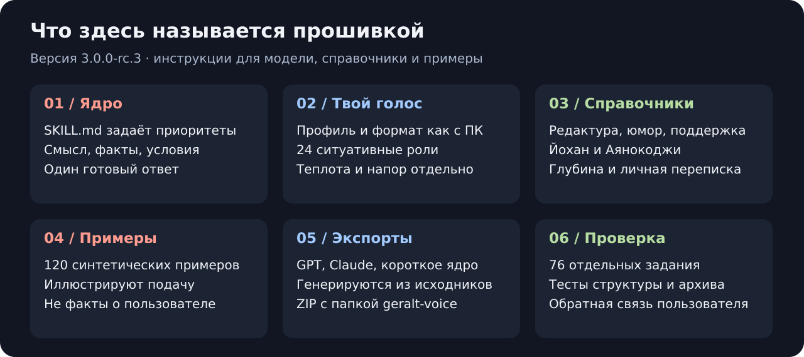
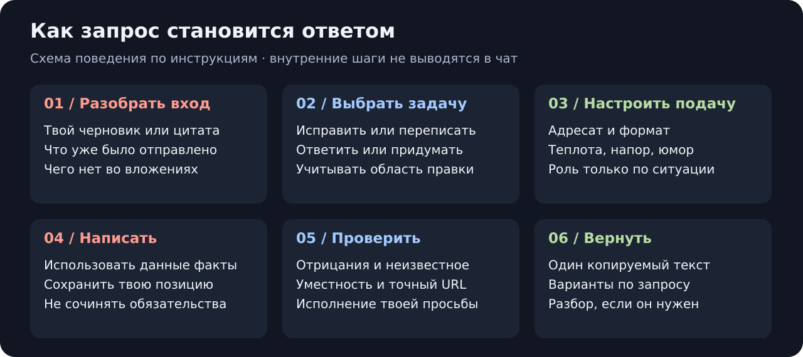
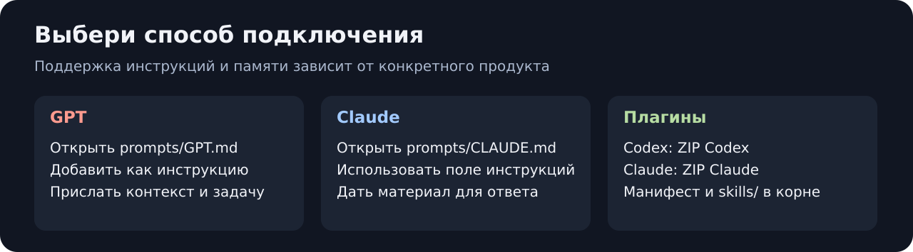
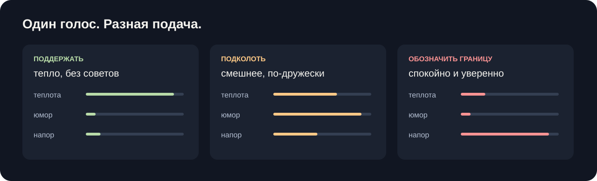
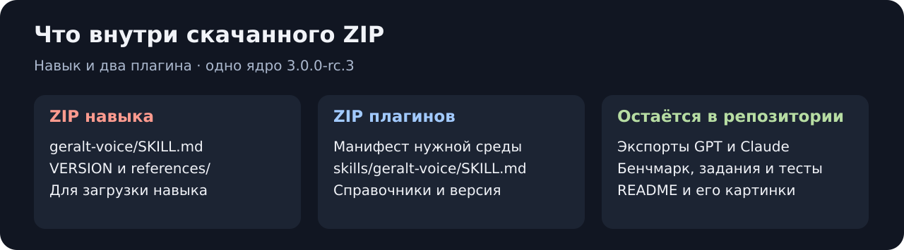
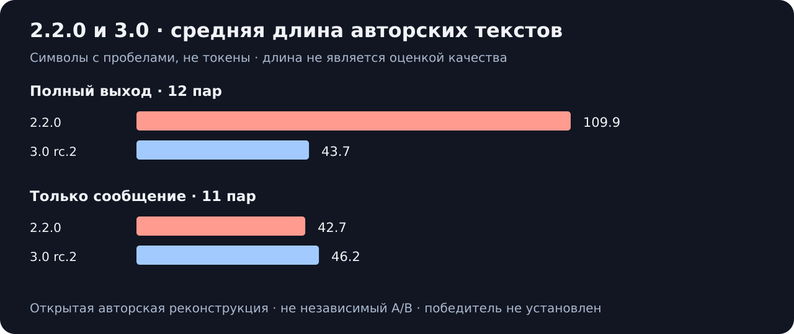

# Geralt Voice 3.0.0-rc.2

**Персональный голос для твоих сообщений.** Поддержать, пошутить, пофлиртовать, ответить уверенно или привести в порядок рабочий текст — с сохранением твоей мысли и фактов.

[**Скачать плагин Codex / GPT ↓**](Geralt%20Voice%20Codex.zip) · [**Скачать плагин Claude ↓**](Geralt%20Voice%20Claude.zip) · [**Инструкция GPT**](prompts/GPT.md) · [**Инструкция Claude**](prompts/CLAUDE.md) · [**Быстрый старт**](prompts/QUICK.md)

| 24 ситуативные роли | 108 авторских примеров | 64 проверочных заданий |
|---|---|---|
| Подача под конкретный разговор | Синтетические демонстрации голоса | Отдельный набор для проверки поведения |

## Что за прошивка



«Прошивка» здесь — набор инструкций для языковой модели. Он задаёт порядок работы, предпочтения голоса и справочники. **Это не отдельная модель и не изменение её весов.** Возможности определяются и инструкциями, и моделью, в которую ты их подключаешь. Текущая версия — **3.0.0-rc.2**, кандидат серии 3.0.

## Как это работает



Например: «Сделай увереннее, возможно, отправлю документ вечером, пока не уверен». Инструкция помогает разделить уверенность в позиции и неизвестный срок:

> возможно, отправлю документ вечером, пока подтвердить не могу

Слово «возможно» сохраняется: более уверенная подача не превращается в обещание. Если нет скриншота или нужного факта, модель должна уточнить существенное, а не сочинять контекст.

## Начни за минуту



**GPT.** Открой [инструкцию GPT](prompts/GPT.md), скопируй её в поддерживаемое поле инструкций или задай как установку текущего чата. Затем пришли контекст и задачу.

**Claude.** Возьми [инструкцию Claude](prompts/CLAUDE.md) и добавь её туда, где твоя среда принимает инструкции. Для короткого знакомства с голосом есть [компактное ядро](prompts/QUICK.md).

### Какой ZIP выбирать

| Где устанавливаешь | Файл | Формат |
|---|---|---|
| Окно «Новый плагин», как на скриншоте; Codex | [**Geralt Voice Codex.zip**](Geralt%20Voice%20Codex.zip) | `.codex-plugin/plugin.json` и `skills/geralt-voice/SKILL.md` в корне |
| Claude Code или совместимый установщик плагинов Claude | [**Geralt Voice Claude.zip**](Geralt%20Voice%20Claude.zip) | `.claude-plugin/plugin.json` и `skills/geralt-voice/SKILL.md` в корне |
| Загрузка именно навыка, например в Claude с поддержкой custom skills | [ZIP навыка](Geralt%20Voice%203.0.0-rc.zip) | Одна папка `geralt-voice/` с `SKILL.md` |
| Обычный чат GPT / Claude, где нет установки плагинов | [GPT.md](prompts/GPT.md) / [CLAUDE.md](prompts/CLAUDE.md) | Текстовая инструкция |

**Для окна со скриншота выбери `Geralt Voice Codex.zip`.** Прежний `Geralt Voice 3.0.0-rc.zip` был пакетом навыка: установщик плагинов не находил в нём манифест или `skills/*/SKILL.md`. Новые архивы содержат эти пути непосредственно в корне, без лишней внешней папки.

Все пакеты используют одно ядро **3.0.0-rc.2** и одинаковые справочники. Различается структура поставки и метаданные среды; в Claude-пакет не включаются настройки интерфейса OpenAI. [Подробная установка и содержимое архивов](docs/INSTALLATION.md).

Загрузка файла в обычный чат не равна установке плагина. Возможности инструкций, памяти и custom skills зависят от продукта.

## Как это звучит



Подача регулируется независимо: теплота, юмор, напор, экспрессия, мат, близость, формальность, объём и глубина. В личном чате базовый формат — строчные и запятые; для рабочих текстов или по запросу — обычная пунктуация.

| Хочешь | Скажи |
|---|---|
| Тёплый ответ | «Ответь ей тепло, как с ПК, без флирта» |
| Удачнее пошутить | «Сделай подкол смешнее, поменяй саму идею» |
| Спокойную уверенность | «Коротко и твёрдо, без наезда» |
| Взаимный флирт | «Подхвати её шутку, мы взаимно флиртуем» |
| Бережную редактуру | «Только ошибки, мои слова не переставляй» |
| Полную переработку | «Перепиши полностью, сохрани смысл и неопределённость» |
| Рабочее сообщение | «Официально, с обычной пунктуацией» |

Есть дополнительные ориентиры подачи: Саня Кинг — бурный комический разгон, Йохан Либерт — спокойная точность, Аянокоджи — лаконичность. Это авторские настройки, не подлинные цитаты. Основой остаётся твой голос.

## Кто за что отвечает


Имена выбирают приёмы подачи, а не знания о собеседнике. Подробности и ограничения — в [профилях](geralt-voice/references/personas.md). В просьбе «теплее, но так же уверенно» можно сохранить позицию и добавить участие.

## Что находится в архиве



В ZIP навыка находится папка `geralt-voice/`; в двух ZIP плагинов — манифест соответствующей среды и `skills/geralt-voice/` с ядром, версией и справочниками. Самостоятельные GPT/Claude-инструкции, картинки и отчёты бери по ссылкам в репозитории. Проверочные задания отделены от демонстраций и не входят в устанавливаемый пакет.

## Новое в rc.2

**Йохан Либерт:** точное наблюдение, содержательное несогласие, спокойный вопрос и граница без театральной угрозы. **Киётака Аянокоджи:** факты отдельно от гипотез, решение по цели, понятный следующий шаг и уверенность без ложных обещаний.

Добавлены 12 демонстраций и 16 отдельных проверочных заданий. В [бенчмарке](BENCHMARK.md) — 24 текста, написанных ассистентом в этой сессии, с разбором слабых мест. Это авторская проверка, не слепой тест. Научные ориентиры и ограничения их проверки вынесены в [источники](docs/SOURCES.md).

## Что изменилось после 2.2.0

- Самостоятельное ядро и справочники вместо наложения старых инструкций.
- Независимые настройки подачи, 24 роли и новый банк примеров.
- Сохранение смысла, отрицаний, неопределённости и обязательств при редактуре.
- Без механического стопа по числу сообщений и обязательного редакторского отчёта.
- Автономные экспорты GPT/Claude и воспроизводимая сборка ZIP.

Подробный [переход с 2.2.0](docs/MIGRATION.md). [Исторический архив 2.2.0](geraltvoice2.2.0.zip) сохранён; одновременно подключать старую и новую инструкции не нужно.

## Бенчмарк: 3.0 против 2.2.0



**12 одинаковых заданий, 24 написанных текста.** Сравниваются архивная 2.2.0 и текущая **3.0.0-rc.2**. Это открытая авторская реконструкция в одной сессии: я прочитал относящиеся к задачам правила и сам написал и оценил оба варианта. Независимый запуск полного старого навыка и слепой A/B не проводились.

| Проверка | Что видно в сохранённых парах |
|---|---|
| Отрицание и неизвестный срок | Обе версии могут сохранить смысл без ложного обещания |
| Прямое «как с ПК» и точный URL | Оба авторских варианта выполняют запрос |
| Формат выдачи | В 2.2.0 обязательны обёртка и отчёт при редактуре; 3.0 возвращает готовый текст |
| Обычный чат без указания формата | Разные умолчания: телефонный формат и ПК |
| Третье сообщение с новым фактом | Разные решения в выбранном примере из-за стоп-правил; частота отказов не измерялась |
| Глубина и спокойная жёсткость | Пригодные ответы возможны в обеих версиях |

График показывает **среднее число символов**, включая оформление в полном выходе. Копируемый текст сравнивается только в 11 парах, где он есть в обеих версиях. Сокращение обёртки не доказывает улучшения естественности. **Процент качества и победитель не установлены.**

[**Все задания, оба ответа и разбор →**](evaluation/COMPARISON.md) · [Сырые пары](evaluation/probes/compare-2.2-vs-3.0.jsonl) · [Условия и хеши](evaluation/probes/compare-metadata.json)

## Что и как проверено


Технические проверки проверяют целостность сборки, а написанные тексты позволяют обсуждать подачу на конкретных примерах. Реакция адресата и предпочтение пользователя требуют отдельной оценки. Проверки с этой страницы описаны в [бенчмарке](BENCHMARK.md).

## Статус выпуска

**Кандидат выпуска.** Автоматические проверки проверяют структуру, данные, экспорты и упаковку. Поведенческие пробы описаны в [отчёте](evaluation/RESULTS.md); границы выводов — в [BENCHMARK.md](BENCHMARK.md). Межпровайдерный A/B GPT и Claude не выполнен. Числа примеров и заданий обозначают покрытие сценариев, а не процент качества; незаметность помощи и симпатия собеседника не гарантируются.

## Материалы

| Файл | Назначение |
|---|---|
| [SKILL.md](geralt-voice/SKILL.md) | Ядро и выбор справочников |
| [Профиль голоса](geralt-voice/references/voice-profile.md) | Обобщённые предпочтения и область действия |
| [Приёмы общения](geralt-voice/references/conversation.md) | Вопросы, поддержка, радость, восстановление разговора |
| [Личная переписка](geralt-voice/references/romance.md) | Интерес, флирт, инициатива и близость |
| [Юмор и напор](geralt-voice/references/humor-conflict.md) | Комические ходы, сарказм и жёсткость |
| [Роли](geralt-voice/references/roles.md) | 24 ситуативные настройки |
| [Примеры](geralt-voice/references/examples.md) | 108 придуманных входов и вариантов |
| [Стратегия](docs/STRATEGY.md) | Решения глобальной переработки |
| [Переход с 2.2.0](docs/MIGRATION.md) | Что заменено и как подключать новую версию |
| [Источники](docs/SOURCES.md) | Исследования, руководства и пределы выводов |
| [Проверка поведения](evaluation/README.md) | Отдельные задания и критерии |
| [История](CHANGELOG.md) | Изменения архитектуры |
| [Метаданные](release.json) | Автоматически полученные версия и числа |

## Разработка

Python 3.10+ и зависимости из [requirements-dev.txt](requirements-dev.txt).

```bash
python3 -m pip install -r requirements-dev.txt
python3 scripts/build.py
python3 scripts/check.py --archive
python3 -m unittest discover -s tests -v
python3 scripts/check_probes.py
python3 scripts/check_comparison.py
python3 scripts/render_readme.py
```

Исходники — SKILL.md, справочники, examples.jsonl и roles.json. Банк Markdown, таблица ролей, prompts, release.json и ZIP генерируются. Сборка воспроизводима; [SHA256SUMS](dist/SHA256SUMS) позволяет проверить архив.

Старые ZIP в корне сохранены. Исторические проценты бенчмарка 2.2.0 были оценкой предписаний правил, а не модельных выходов. Приватные логи и сведения о собеседниках в новый публичный пакет не включены.
